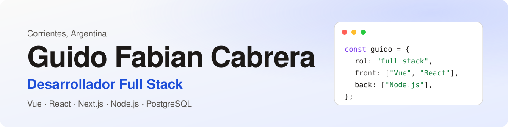

  <picture>
    <source media="(prefers-color-scheme: dark)" srcset="assets/banner-dark.svg">
    
  </picture>

  

    
    
    
  

## Sobre mí

- Desarrollador full stack con más de 4 años de experiencia. Desde 2024 en **GivU**, una plataforma mexicana de recommerce de celulares: backend en Node.js, paneles de administración en Vue y Next.js, e integraciones con servicios externos (WhatsApp y SMS, envíos, WordPress, evaluación de fotos con IA). El código es privado.
- Antes, dos años como front-end con Vue en el sistema de gestión de una empresa de emergencias médicas.
- Proyecto propio: **[Mostrador Online](https://mostradoronline.com.ar)**, catálogos con pedidos por WhatsApp para comercios de Corrientes.
- Uso asistentes de IA (Claude Code) en mis proyectos personales.

## Stack

## Dónde ver mi trabajo

| Proyecto | Qué es |
| --- | --- |
| [Portfolio](https://github.com/GuidoFabianCabrera/guidofabiancabrera.github.io) | Mi sitio personal, en español e inglés. Next.js, TypeScript y Tailwind. |
| [Mostrador Online](https://mostradoronline.com.ar) | Plataforma multi-tenant de catálogos con pedidos por WhatsApp. En validación. |

---

English: full stack developer based in Corrientes, Argentina. Vue, React and Node.js. See my <a href="https://guidofabiancabrera.github.io/en/">portfolio</a>.
